# Nest

Nest is the best open-source app for running many coding agents at once. Start a chat on one task, then another and another: each agent works on its own, in its own git worktree, so they can change the same project side by side without getting in each other's way. You watch them all in one window, and whatever needs you (a question, a permission, work to review) waits in one list, so you can move between them instead of waiting on any one. Pixies, agents you keep, take on jobs of their own, and Autopilot keeps a chat going while you're away.

The agents are the real ones (Claude Code, Codex, a few others, or a model on your own computer), running on your own plan and your own setup: your CLAUDE.md, skills, plugins, MCP servers and hooks all load as they do in the terminal. It runs on your machine, with a Mac app, a Linux app and an iPhone app.

<p align="center">
  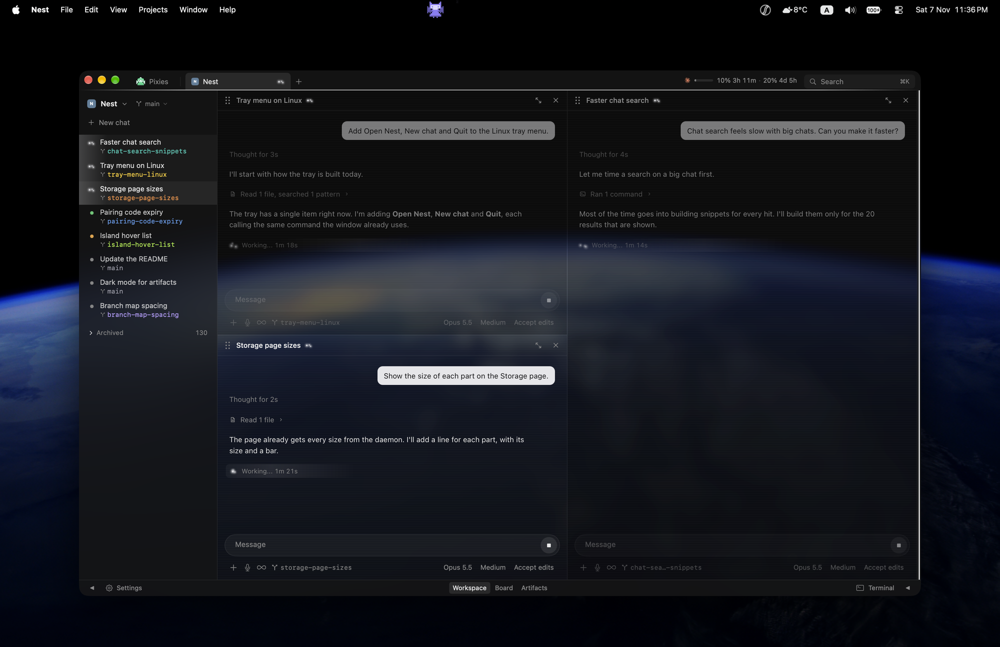
</p>

## Install

On a Mac with Apple silicon and macOS 26 or later, or on x86_64 or arm64 Linux with Ubuntu 22.04 or later, paste this in a terminal:

```sh
curl -fsSL https://github.com/yiorgospapadopoulos/nest/releases/latest/download/install.sh | sh
```

It needs no developer tools and nothing else installed. It downloads Nest, checks every file against its sha256, starts the background service and opens the app. You can run the same line again at any time to repair an install; it keeps your chats.

Nest goes in `/Applications` on a Mac (run it from an administrator account) and in your app menu on Linux, with no `sudo`. It changes no shell files: if `~/.local/bin` is not on your `PATH`, the script prints the line to add. When the background service is down, Nest first starts it again itself, and only shows this line if that fails. It refuses to run over a Nest that runs from a source checkout.

On Linux Nest needs a systemd user session and the Secret Service, which Ubuntu has. Without them the script says what is missing and stops.

Downloading the Mac app from the Releases page in a browser also works, but as the app has no paid Apple signing, macOS blocks it once: open System Settings > Privacy & Security > Open Anyway. The line above skips that.

## First run

The app opens on a short guide. Each step says whether it is done, and you can skip any of them but the first. Afterwards, Settings > General > Set up Nest shows every step and what is still missing.

1. **Engine.** Sign in to Claude Code or Codex with your own plan, or choose local models only. Nest needs one engine to work.
2. **git.** On a Mac, Install opens Apple's installer for the command line tools.
3. **GitHub.** Sign in with the `gh` tool, for pull requests and issues.
4. **Background service.** Nest's own server on this computer, which the installer already started.
5. **Tailscale and iPhone.** See [iPhone](#iphone) below.
6. **Notifications** and **Dictation.** macOS asks for each.
7. **First chat.** Add a project folder and send one message to check it all works.

## A tour

### Start a chat

Each project opens on its start screen. Write what you want in the box at the bottom and send it. The row under the box sets how the chat runs: **+** adds files or pictures, the mic dictates, the infinity button turns on Autopilot, and **Work on main** says where the chat works. On the right you pick the model, how hard it thinks and how much it may do without asking (Ask, Accept edits, Bypass and the others Claude Code has).

<p align="center">
  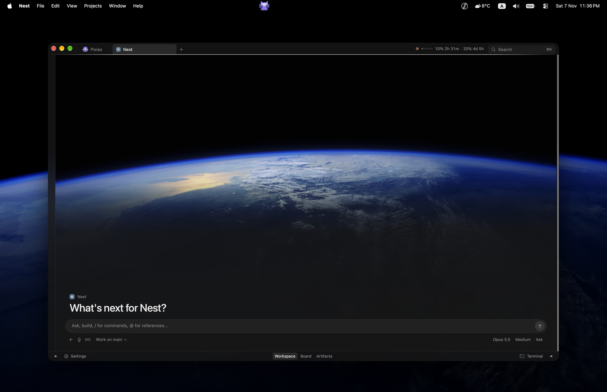
</p>

### Your chats and what needs you

The left bar lists the project's chats, newest activity first, with a coloured dot for each one's state; finished ones fold into Archived. The right panel has two parts. **Needs you** collects everything waiting for you, such as a question, a permission or work to review, and you can answer each one in place. **Goals** shows each working chat's plan as a checklist that ticks off as it goes. Both bars fold away when you want the room.

<p align="center">
  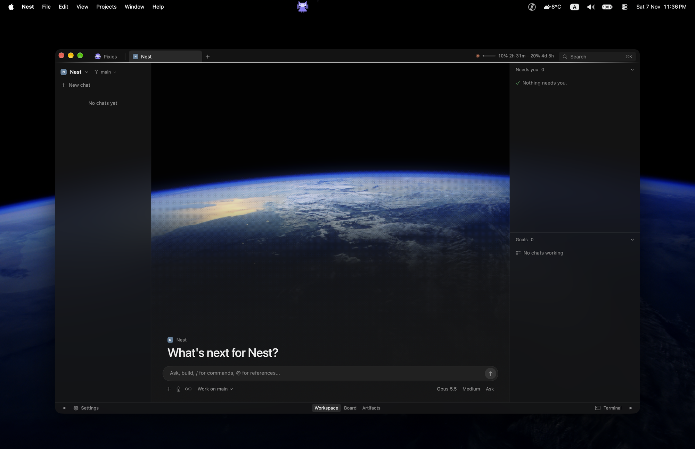
</p>

### Several chats at once

Open up to four chats side by side, each in its own pane, and drag a pane to split the space another way. Every pane shows what its agent is doing live: what it thought about, which files it read, what it ran, and how long it has been working. The usage meter at the top right shows how much of your plan's 5-hour and weekly limits is used.

<p align="center">
  
</p>

### Pixies

Pixies are agents you set up once and keep. Each has a name, a pixel-art mascot and colour, its own model and permissions, standing instructions (its soul) and a memory that grows as it works. Type `@` in any chat to hand part of the work to one, or put several in a team with a leader who shares out the work. A pixie's details also hold its habits, jobs it runs on a schedule or when something happens, such as a chat failing.

<p align="center">
  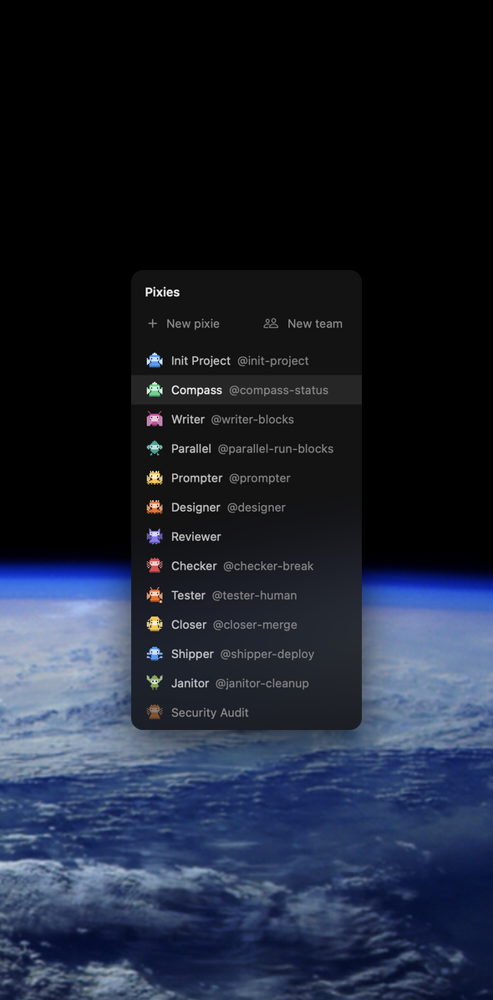
  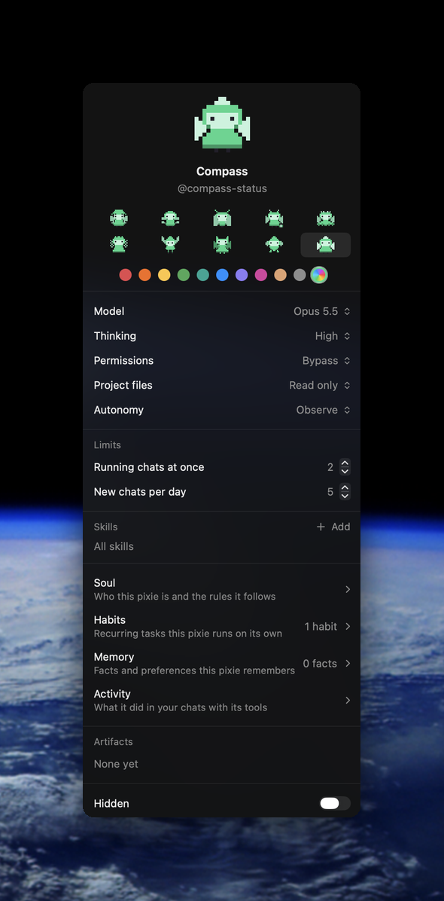
</p>

To start with, here are some pixies worth having. Each soul is ready to paste in [Recommended pixies](docs/recommended-pixies.md).

| Pixie | Its one job |
|---|---|
| `@designer` | Makes 2 to 4 design options to choose from, as one artifact |
| `@reviewer` | Reviews a change it did not build and says if it is safe to accept |
| `@checker` | Tries to break what was just built before you rely on it |
| `@tester` | Opens what was just built and tells you what to try |
| `@closer` | Merges a finished worktree's job back and cleans up |
| `@shipper` | Puts what is merged live, backing up first |
| `@janitor` | Removes worktrees and branches it can prove are finished |
| `@security-audit` | Runs a full security audit of a project when you ask, with Cloudflare's open security-audit skill |

### Artifacts

When an agent makes a report, a plan, slides, a mockup or a chart, Nest keeps it as an artifact instead of a long message or a file left in your repo. Artifacts open in the app, keep every version, and can be interactive pages. The Artifacts view lists them by chat or for the whole project.

<p align="center">
  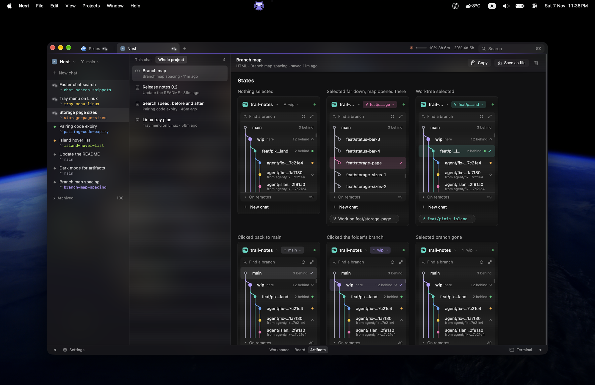
</p>

### Worktrees

A chat can work in the project folder or in its own git worktree, a separate folder on its own branch. Then several chats can change the same project at the same time without getting in each other's way. The branch shows in colour under the chat's name and under the message box. Ask a chat to make a new worktree or delete its own and it does.

<p align="center">
  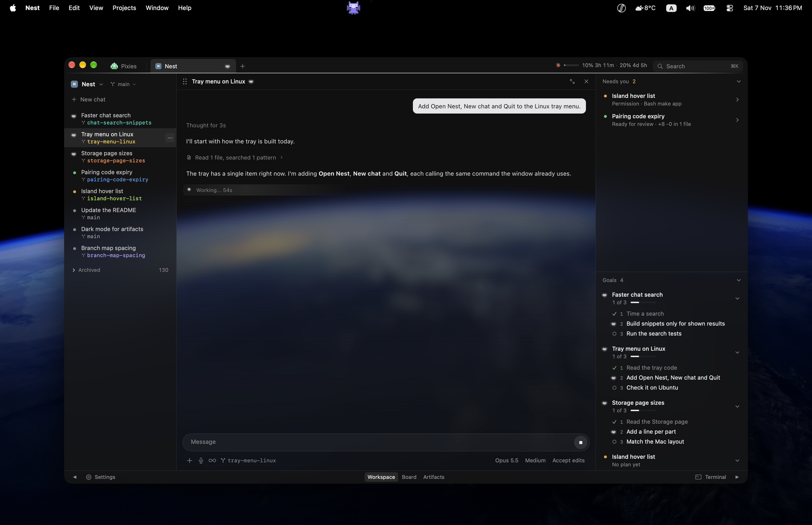
</p>

### The branch map

Click the branch next to the project's name to open the branch map. It draws every branch of the project as a tree from `main`, nests a branch under the one it came from, and marks the ones with a worktree. Pick a branch or worktree there and new chats start on it. **Find a branch** narrows a long list.

<p align="center">
  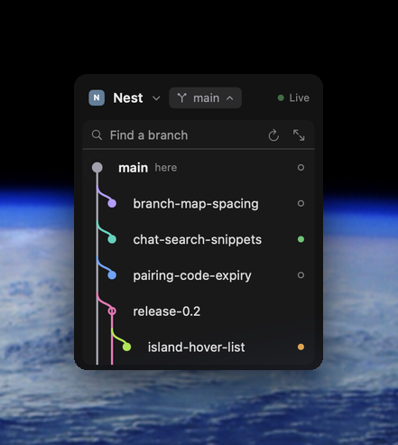
</p>

### Reviews and pull requests

When a turn changes files, a bar above the message box shows what changed. **Review** opens the diff. **Approve** commits it, and for a worktree chat also pushes the branch and opens a pull request. Nest then follows the pull request's checks: if they fail, it can send the failing log to the chat; when they pass, it offers the merge.

### The board

The board shows every chat of the project as a card, in columns by where it stands: running, waiting on you, ready for review and done. Click a card to open its chat. It sits next to Workspace and Artifacts at the bottom of the window.

<p align="center">
  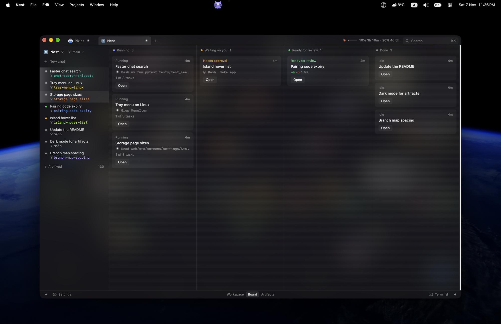
</p>

### Autopilot

Turn on Autopilot with the infinity button and the chat keeps working while you're away. Nest answers its questions with the option the agent recommends, approves its plans, and nudges it on when it stops early. A bar above the message box shows the step it is on and how long is left. The menu sets when it stops: when the task is done, or after a time you pick, and optionally at a weekly usage cap. When it ends, the chat shows what was decided while you were gone.

<p align="center">
  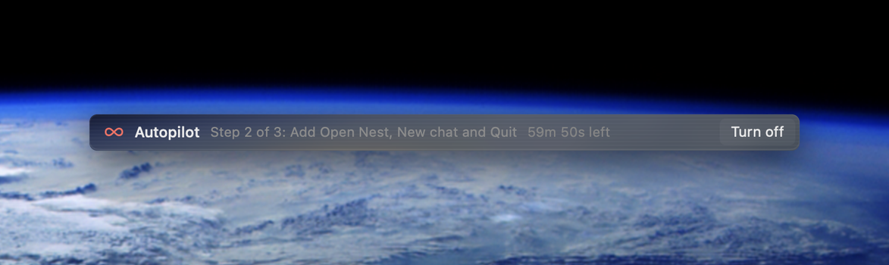
</p>

<p align="center">
  
</p>

### The island

While Nest runs, a strip around the MacBook's notch shows your pixies at work: the ones working on the left, the ones that finished or need you on the right. Hover over it to see the list, with what each pixie is doing now, and click one to open its chat.

<p align="center">
  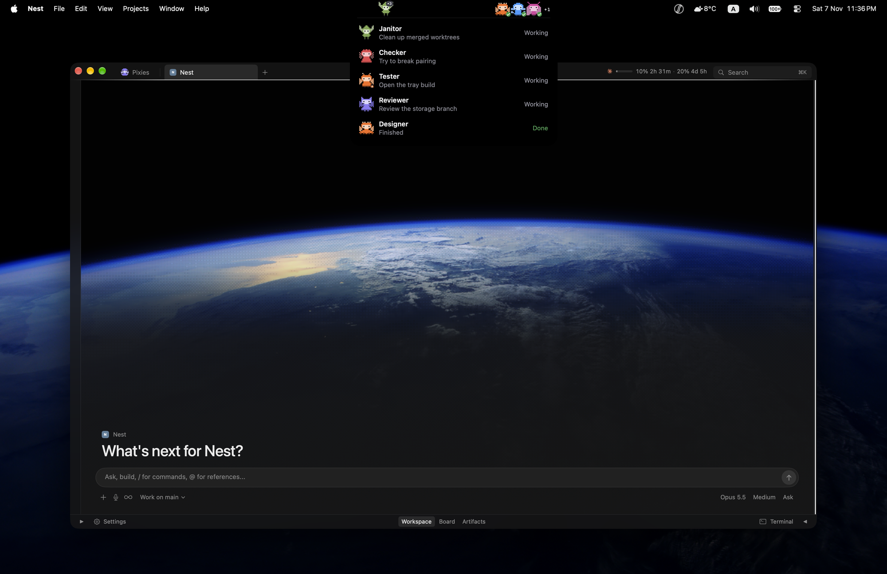
</p>

### Also in Nest

- **More engines.** Besides Claude Code and Codex, chats can run on OpenCode, Gemini CLI or a model on your own computer (LM Studio, Ollama and others), all from one model menu. See [Local models](docs/using-nest.md#local-models) and [More engines](docs/using-nest.md#more-engines-agent-client-protocol).
- **Several accounts.** Sign in more than one plan per engine and switch which one chats use. See [Accounts](docs/using-nest.md#settings-storage-pixies-and-accounts).
- **Your terminal chats.** Chats you started in Claude Code or Codex outside Nest show up too, and **Continue in Nest** picks one up. See [Chats from Claude Code and Codex](docs/using-nest.md#chats-from-claude-code-and-codex).
- **GitHub issues.** The start screen lists the project's open issues; click one to start a chat on it. See [GitHub issues](docs/using-nest.md#github-issues-and-review-comments).
- **Terminals, browsers and dev servers.** Open a terminal or a browser as a pane, and run the project's dev server per chat, each worktree on its own ports. See [Terminal and browser panes](docs/using-nest.md#terminal-and-browser-panes) and [Dev servers](docs/using-nest.md#dev-servers).
- **Usage limits.** When you hit your plan's limit, a chat pauses and carries on by itself once the limit resets. See [What the agent is doing](docs/using-nest.md#what-the-agent-is-doing).
- **Search.** Find any chat by what was said in it. See [Search](docs/using-nest.md#search).
- **Linux and another machine.** A Linux app that works like the Mac app, and a Mac app that can drive Nest on another computer of yours. See [Linux desktop app](docs/using-nest.md#linux-desktop-app) and [A daemon on another machine](docs/using-nest.md#a-daemon-on-another-machine).

Everything else, feature by feature, is in [Using Nest](docs/using-nest.md).

## iPhone

The iPhone app is a web app served by Nest on your computer. It reaches it through [Tailscale](https://tailscale.com), a free private network between your own devices, never the public internet.

1. Install Tailscale on the computer and the iPhone and sign in to the same account on both.
2. In the guide's Tailscale step, press **Share with my devices**.
3. The guide shows an address and a one-time code (later: Settings > Devices > Pair a device). Open the address in Safari on the iPhone and enter the code.
4. In Safari, Share > Add to Home Screen. Open Nest from the Home Screen and turn on Settings > Notifications there to get push notifications.

Every device can be revoked in Settings > Devices.

## What Nest asks for and why

| Permission | Why |
|---|---|
| Keychain (Secret Service on Linux) | Device tokens and the keys you give Nest are kept there and nowhere else. The app gets its own token from the background service, so it never asks for your Keychain password. |
| Notifications | To tell you when a chat needs you, has work to review or finishes. |
| Microphone and speech recognition | Only for Dictation, while you dictate a message. Speech is turned into text on the Mac. |
| Accessibility (optional) | Lets the pixie strip around the notch see where the menu bar is free, so it can grow into that space. |
| Tailscale sharing | Share with my devices makes Nest reachable at your private tailnet address, so the iPhone can open it. `tailscale serve --https=443 off` stops it. |

## Privacy

Nest sends nothing home. Your chats, settings and files stay on your computer. Nest talks only to the engines you sign in to and to GitHub, as you, through your own logins, and, when an app opens, to GitHub, PyPI and npm to look for updates. It never reads or keeps your passwords, and there is no Nest account or server.

## Updates

When a new Nest is out, the app downloads it in the background, checks it runs, and only then shows the strip. Relaunch to update installs it together with any engine updates, after a backup of the database in `backups-update/`, and permissions stay. While it updates, the app says so. If the new version does not start, Nest goes back to the old one and the old database by itself, within seconds when it keeps crashing and after 2 minutes when it hangs, and tells you. Undo update in Settings > General goes back one version, unless the update changed the database. Updates start from the Mac and Linux apps; the iPhone app follows the computer.

## Something's wrong

`nest doctor` says in plain words what is wrong and how to fix it, and it works with the background service down. Settings > General > Set up Nest shows the same checks. `nest doctor --report`, or Settings > General > Report a bug, writes a file to `reports/` in Nest's data folder with versions, check results and the end of the log, with tokens, keys, URL credentials, emails and home paths removed. Nest sends it nowhere itself: read it, then Report on GitHub opens a new issue with the report filled in for you to send (or asks you to attach the file, when it is too long).

## Uninstall

Settings > General > Uninstall Nest, or `nest uninstall` in a terminal, stops the service and removes the app, the `nest` command and Nest's programs. It keeps your chats, settings and secrets, says where they are, and installing again brings them back. Choose to delete them too in the app, or run `nest uninstall --delete-data`. It leaves `tailscale serve` alone and tells you how to stop it.

## Contributing

Bug reports are welcome; see [CONTRIBUTING.md](CONTRIBUTING.md). Working on Nest itself is described in [Working on Nest](docs/development.md).

## License

[MIT](LICENSE)
